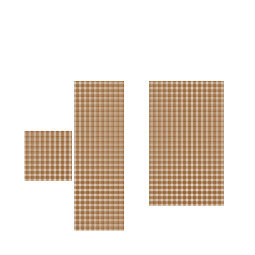

# 基于taichi的2D PBD Fluid模拟

## 背景简介

基于taichi语言的[PBD Fluid](https://dl.acm.org/doi/10.1145/2461912.2461984) demo，基于 [WCSPH](https://github.com/taichiCourse01/taichi_sph) 的代码改编。

## 效果展示

PBD Fluid相比SPH最大的优势就是在大时间步长下抗造，相同时间步长下PBD Fluid与WCSPH的效果对比如图所示（在本人的测试中PBD Fluid大概在步长为$0.032$时扛不住）

|            | PBD                    | WCSPH                    |
| ---------- | ---------------------- | ------------------------ |
| $dt=0.001$ |  |  |
| $dt=0.004$ |  |  |


## 运行环境

```
[Taichi] version 0.8.3, llvm 10.0.0, commit 2680dabd, linux, python 3.8.10
```

## 运行方式
`python3 demo.py`
